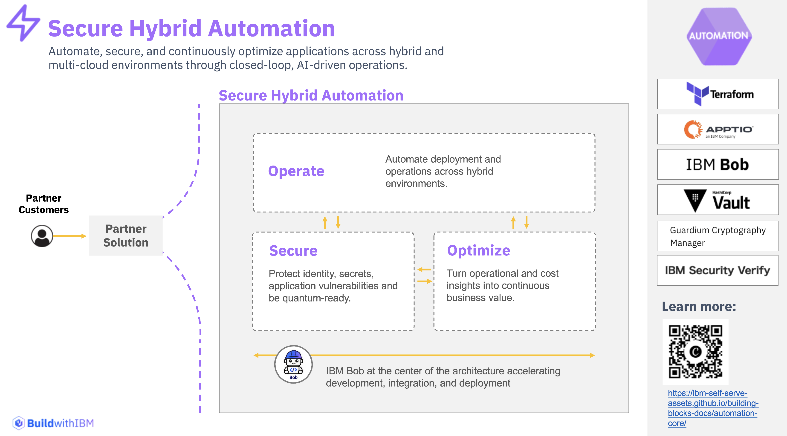
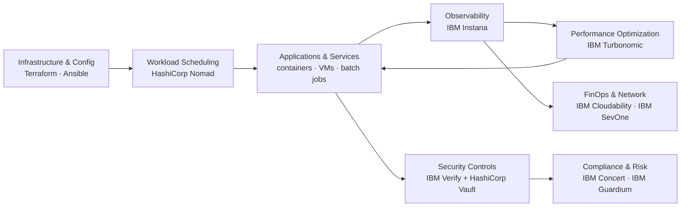

# Automation – Secure Hybrid Automation

!!! abstract "Executive Overview"
    **Automation turns complex hybrid estates into secure, observable, and continuously optimized operations.** By bringing together infrastructure automation, identity and compliance controls, and AI-driven observability and optimization in one composable architecture, Automation helps enterprises reduce manual toil, strengthen security posture, and control cost and performance across hybrid cloud environments.

    Its open, modular approach enables organizations to provision consistently, secure non-human identities, prepare for quantum-safe cryptography, and optimize applications, spend, and networks—**without replacing existing investments**.

The **Automation Building Blocks** provide a practical, composable foundation for **operating, securing, and optimizing** enterprise applications and infrastructure across hybrid cloud environments. The model is organized around three pillars: **Operate**, **Secure**, and **Optimize**. Each block can be adopted independently or combined into an end-to-end automation and resilience architecture, giving sales and technical teams a repeatable play to start from the business outcome and choose the smallest block that solves it.

---

---

## Strategic Value Drivers

=== "Faster, Consistent Delivery"
    - **Declarative Infrastructure:** Replace manual provisioning with version-controlled, repeatable code using **HashiCorp Terraform**.
    - **Agentless Configuration at Scale:** Enforce the same desired state across thousands of nodes with **Red Hat Ansible Automation Platform**.
    - **Unified Workload Scheduling:** Run containers, VMs, batch jobs, and binaries from a single control plane with **HashiCorp Nomad**.

=== "Zero-Trust Security & Compliance"
    - **No Standing Credentials:** Replace long-lived passwords and API keys with dynamic, short-lived secrets via **IBM Verify** and **HashiCorp Vault**.
    - **Continuous Compliance:** Monitor CVEs, certificates, and compliance posture across hybrid environments with **IBM Concert**.
    - **Quantum-Safe Readiness:** Discover cryptographic assets and plan migration to post-quantum algorithms with **IBM Guardium Cryptography Manager**.

=== "Performance & Cost Optimization"
    - **Full-Stack Visibility:** Get automated, real-time observability and AI-correlated root-cause analysis across every application tier with **IBM Instana**.
    - **Demand-Driven Resourcing:** Continuously balance performance and cost with **IBM Turbonomic**.
    - **Financial Transparency:** Attribute cloud spend to teams, projects, and business units with **IBM Cloudability / Apptio**.

=== "Proactive Operations"
    - **Reduced Operational Risk:** Detect drift and reconcile automatically with policy-as-code.
    - **Faster Incident Resolution:** Cut MTTR from hours to minutes with correlated, AI-assisted insight.
    - **Network Awareness:** Surface anomalies before users are impacted using sub-minute polling and dynamic baselines in **IBM SevOne**.

---

## Building Block Map

The Automation architecture is organized into three foundational pillars: **Operate**, **Secure**, and **Optimize**.

| Pillar | Building Block | Primary Products | What It Enables |
|:---|:---|:---|:---|
| **Operate** | [**Infrastructure as Code**](operate/infrastructure-as-code.md) | HashiCorp Terraform | Declarative, version-controlled provisioning across hybrid and multi-cloud environments |
| **Operate** | [**Configure & Automate**](operate/configure-automate.md) | Red Hat Ansible Automation Platform | Agentless, idempotent configuration management and IT automation at enterprise scale |
| **Operate** | [**Workload Orchestration & Scheduling**](operate/workload-orchestration.md) | HashiCorp Nomad | Unified scheduling of containers, VMs, batch jobs, and binaries under a single control plane |
| **Secure** | [**Non-human Identity & Secret Management**](secure/non-human-identity.md) | IBM Verify + HashiCorp Vault | Centralized identity governance and dynamic secrets management across hybrid environments |
| **Secure** | [**Application Risk & Continuous Compliance**](secure/application-risk.md) | IBM Concert | Unified application risk visibility, CVE monitoring, and automated compliance posture management |
| **Secure** | [**Cryptographic & Quantum-Safe Readiness**](secure/cryptographic-readiness.md) | IBM Guardium Cryptography Manager | Discover, govern, and migrate cryptographic assets to quantum-safe algorithms |
| **Optimize** | [**Full-Stack Application Observability**](optimize/full-stack-observability.md) | IBM Instana | Automated, real-time visibility across every tier of hybrid applications |
| **Optimize** | [**Application Performance**](optimize/application-performance.md) | IBM Turbonomic | Demand-driven resource optimization balancing performance and cost continuously |
| **Optimize** | [**Technology Financial Management & FinOps**](optimize/technology-financial-management.md) | IBM Cloudability / Apptio | Granular cloud spend visibility, cost allocation, and forecasting |
| **Optimize** | [**Network Performance Management**](optimize/network-performance.md) | IBM SevOne Network Performance Management | High-frequency network monitoring, capacity planning, and AI-powered anomaly detection |

---

## 1. Operate

> **Mission:** Automate infrastructure provisioning, configuration management, and workload scheduling to deliver consistent, repeatable pipelines across hybrid cloud environments — reducing manual toil and enabling teams to focus on higher-value work.

!!! success "Core Business Outcomes"
    - **Faster Delivery:** Replace manual provisioning steps with declarative, version-controlled infrastructure code.
    - **Consistent Configuration:** Enforce the same desired state across thousands of nodes without deploying agents.
    - **Flexible Workload Management:** Schedule containers, VMs, batch jobs, and binaries from a single control plane.
    - **Reduced Operational Risk:** Drift detection, automated reconciliation, and policy-as-code prevent configuration creep.

??? info "When to deploy the Operate pillar"
    - Infrastructure must be **provisioned predictably and repeatably** across multiple clouds or data centres.
    - Teams need to **enforce consistent OS and application configuration** at scale without agent overhead.
    - Diverse workload types — containers, batch jobs, legacy binaries — need to run under a **unified scheduler**.
    - You want IaC, configuration, and scheduling pipelines **integrated with CI/CD**.

[Explore Operate Building Blocks →](operate/index.md)

---

## 2. Secure

> **Mission:** Protect enterprise applications, data, and infrastructure through comprehensive identity management, continuous compliance monitoring, and quantum-safe cryptographic capabilities.

!!! success "Core Business Outcomes"
    - **Eliminated Standing Credentials:** Dynamic, short-lived secrets replace long-lived passwords and API keys.
    - **Continuous Compliance:** Automated drift detection against SOC 2, HIPAA, and PCI-DSS reduces audit effort.
    - **Proactive Vulnerability Management:** Real-time CVE prioritization and certificate lifecycle management prevent outages.
    - **Quantum-Safe Readiness:** Discover all cryptographic assets and plan migration to NIST-approved post-quantum algorithms before the deadline.

??? info "When to deploy the Secure pillar"
    - Applications and pipelines need **non-human identities and short-lived credentials** instead of static secrets.
    - You need a **continuous, unified view of application risk and compliance posture** across hybrid environments.
    - Certificate sprawl or upcoming renewals pose an **operational availability risk**.
    - The organization must assess and migrate its **cryptographic inventory ahead of post-quantum requirements**.

[Explore Secure Building Blocks →](secure/index.md)

---

## 3. Optimize

> **Mission:** Continuously improve observability, application performance, cost efficiency, and network health through intelligent automation and analytics.

!!! success "Core Business Outcomes"
    - **Faster Incident Resolution:** AI-correlated root-cause analysis reduces MTTR from hours to minutes.
    - **Balanced Performance and Cost:** Demand-driven resource optimization avoids both over-provisioning and performance degradation.
    - **Financial Transparency:** Granular attribution of cloud spend to teams, projects, and business units enables chargeback and FinOps discipline.
    - **Proactive Network Operations:** Sub-minute polling and dynamic baselines surface anomalies before users are impacted.

??? info "When to deploy the Optimize pillar"
    - Hybrid applications span many tiers and teams need **full-stack visibility without manual instrumentation**.
    - Kubernetes and cloud resource costs are rising and **workload placement needs to be continuously rebalanced**.
    - Cloud spend is growing but **attribution to teams or products is unclear**.
    - Network capacity planning relies on manual reports and **reactive alerting**.

[Explore Optimize Building Blocks →](optimize/index.md)

---

## Reference Architecture

!!! note
    This is a **reference composition**, not a requirement to deploy every product. Select only the capabilities needed for the use case.

---

## Solution Selection Guide

| Customer Requirement / Pain Point | Recommended Starting Building Blocks | Primary Technology |
|:---|:---|:---|
| *"Infrastructure provisioning is inconsistent across clouds"* | [**Infrastructure as Code**](operate/infrastructure-as-code.md) | HashiCorp Terraform |
| *"Configuration drift is causing reliability issues"* | [**Configure & Automate**](operate/configure-automate.md) | Red Hat Ansible Automation Platform |
| *"We need one scheduler for containers, batch, and legacy workloads"* | [**Workload Orchestration & Scheduling**](operate/workload-orchestration.md) | HashiCorp Nomad |
| *"Applications are using long-lived static secrets and API keys"* | [**Non-human Identity & Secret Management**](secure/non-human-identity.md) | IBM Verify, HashiCorp Vault |
| *"We need continuous visibility into CVEs and compliance posture"* | [**Application Risk & Continuous Compliance**](secure/application-risk.md) | IBM Concert |
| *"We need to assess and migrate cryptographic assets for post-quantum"* | [**Cryptographic & Quantum-Safe Readiness**](secure/cryptographic-readiness.md) | IBM Guardium Cryptography Manager |
| *"We can't see what is happening across all tiers of our application"* | [**Full-Stack Application Observability**](optimize/full-stack-observability.md) | IBM Instana |
| *"Cloud costs are growing and workload placement is suboptimal"* | [**Application Performance**](optimize/application-performance.md) | IBM Turbonomic |
| *"Cloud spend is not attributed to teams or products"* | [**Technology Financial Management & FinOps**](optimize/technology-financial-management.md) | IBM Cloudability / Apptio |
| *"Network issues are discovered reactively and capacity is unclear"* | [**Network Performance Management**](optimize/network-performance.md) | IBM SevOne NPM |

---

## Technology Stack Matrix

| Product | Architecture Pillar | Role in Automation |
|:---|:---|:---|
| **[HashiCorp Terraform](https://www.ibm.com/products/hashicorp)** | Operate | Declarative infrastructure as code for hybrid and multi-cloud provisioning |
| **[Red Hat Ansible Automation Platform](https://www.ibm.com/products/ansible)** | Operate | Agentless configuration management and IT automation at enterprise scale |
| **[HashiCorp Nomad](https://www.ibm.com/products/hashicorp)** | Operate | Unified workload scheduler for containers, VMs, batch jobs, and binaries |
| **[IBM Verify](https://www.ibm.com/products/verify-identity)** | Secure | Identity governance, SSO, MFA, and adaptive access for users and service accounts |
| **[HashiCorp Vault](https://www.ibm.com/products/hashicorp)** | Secure | Dynamic secrets management, automated rotation, and CI/CD secret injection |
| **[IBM Concert](https://www.ibm.com/products/concert)** | Secure | Continuous CVE monitoring, compliance posture management, and certificate lifecycle |
| **[IBM Guardium Cryptography Manager](https://www.ibm.com/products/guardium-data-security-center)** | Secure | Cryptographic discovery, CBOM generation, and post-quantum migration planning |
| **[IBM Instana](https://www.ibm.com/products/instana)** | Optimize | Zero-config full-stack observability with AI root-cause analysis and topology mapping |
| **[IBM Turbonomic](https://www.ibm.com/products/turbonomic)** | Optimize | Demand-driven application performance and resource optimization |
| **[IBM Cloudability / Apptio](https://www.ibm.com/products/apptio)** | Optimize | Technology financial management, cost allocation, and FinOps for cloud investments |
| **[IBM SevOne Network Performance Management](https://www.ibm.com/products/sevone-network-performance-management)** | Optimize | High-frequency network monitoring, capacity planning, and anomaly detection |
