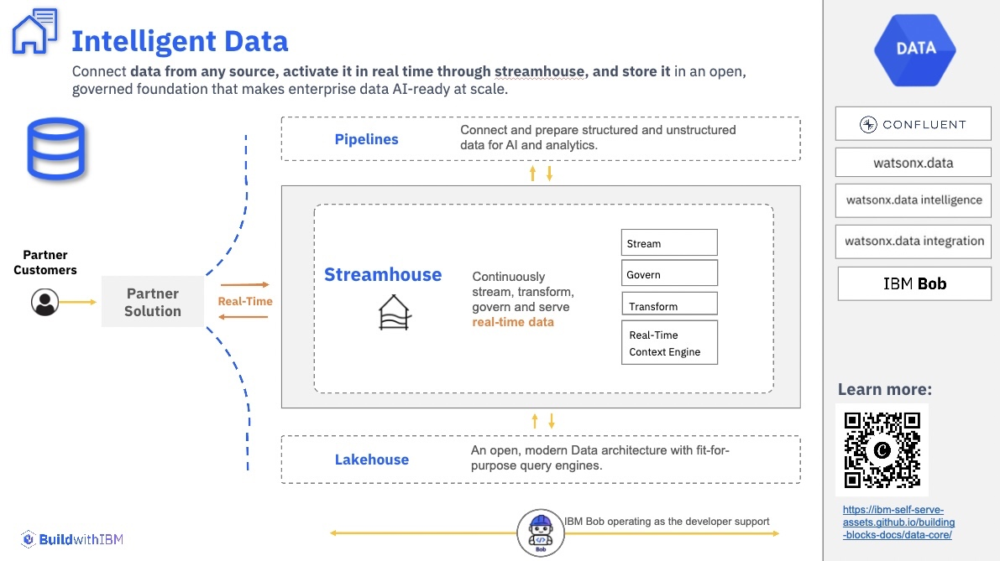
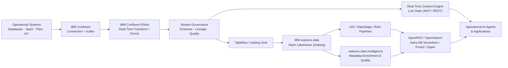

# Intelligent Data

!!! abstract "Executive Overview"
    **Intelligent Data, powered by [Streamhouse](real-time/index.md), keeps AI grounded in what is happening in the business right now.** **Streamhouse** captures, transforms, governs and serves events as they occur, so applications and AI agents work from live context instead of stale batch snapshots. It eliminates data silos, accelerates AI adoption, and delivers trusted, up-to-date insights across applications and operations.
    
    Its open, composable approach lets organizations activate real-time context, deliver trusted data products, and reduce data duplication and integration complexity—**without replacing existing investments**.

The **Intelligent Data Building Blocks** accelerate the journey from architecture to business outcomes. Anchored by the **Streamhouse** reference architecture for data in motion and extended by **Pipelines** and **Lakehouse**, these reusable implementation assets and IBM Bob skills help sales and technical teams rapidly identify customer opportunities, demonstrate value through targeted use cases, and accelerate deployments across hybrid cloud environments. Together, they create a repeatable sales play that moves customers from real-time events to AI-ready, governed, intelligent insight.

---

---

## Strategic Value Drivers

=== "Accelerate AI Time-to-Market"
    - **Live Context for Autonomous Agents:** Ground GenAI models and AI agents with sub-second operational state using the **Real-Time Context Engine (RTCE)**.
    - **Turnkey Enterprise RAG:** Deploy production-grade document intelligence with **Docling** and **OpenSearch** hybrid retrieval out of the box.
    - **Natural Language Data Access:** Empower business users to query governed enterprise databases in plain English via **watsonx Text2SQL**.

=== "Reduce TCO with Zero-Copy Data"
    - **Query Distributed Data in Place:** Leverage **Presto ANSI SQL federation** across databases, object stores, and clouds without duplicate ETL pipelines.
    - **Open Table Standard (Apache Iceberg):** Eliminate vendor lock-in with shared, open Iceberg table formats across Spark, Presto, and Flink.
    - **Fit-for-Purpose Compute:** Route interactive SQL to Presto and heavy transformations to Spark to optimize infrastructure spend.

=== "Enterprise Trust & Governance"
    - **Automated Metadata & Quality:** Automatically catalog, enrich with business glossaries, and enforce data quality rules via **watsonx.data intelligence**.
    - **Proactive Observability:** Detect pipeline failures, data drift, volume anomalies, and SLA breaches before business impact with **Databand**.
    - **End-to-End Lineage:** Trace data lineage across streaming topics, ETL transformations, and lakehouse tables with **OpenLineage**.

=== "Sub-Second Operational Freshness"
    - **Data in Motion:** Stream enterprise events and Change Data Capture (CDC) with **IBM Confluent (Kafka)**.
    - **Continuous Processing:** Filter, join, and aggregate live data streams in motion with **Apache Flink**.
    - **Instant Lakehouse Sinks:** Automatically publish live event streams into open Iceberg tables via Tableflow.

---

## Building Block Map

The Intelligent Data architecture is organized into three foundational pillars: **Pipelines**, **Streamhouse**, and **Lakehouse**.

| Pillar | Building Block | Primary Products | What It Enables |
|:---|:---|:---|:---|
| **Pipelines** | [**RAG**](pipelines/rag/index.md) | IBM watsonx.data (OpenRAG / OpenSearch) | Ground applications and agents with governed enterprise documents, vector search, and hybrid retrieval |
| **Pipelines** | [**UDI**](pipelines/udi/index.md) | IBM watsonx.data integration, IBM Docling | Ingest, parse, cleanse, chunk, and structure complex unstructured documents for RAG and AI |
| **Pipelines** | [**Text2SQL**](pipelines/text2sql/index.md) | IBM watsonx.data intelligence | Convert natural-language questions into SQL queries using vectorized and enriched metadata context |
| **Pipelines** | [**ETL**](pipelines/etl/index.md) | IBM watsonx.data (DataStage) | Build governed visual batch integration flows across source systems, transformations, and lakehouse targets |
| **Pipelines** | [**Data Sync**](pipelines/data-sync/index.md) | Aspera | Synchronize large file sets, media, and AI repositories securely across WAN and hybrid environments at wire speed |
| **Streamhouse** | [**Stream**](real-time/stream/index.md) | IBM Confluent — Connectors & Kafka | Capture and transport enterprise event streams and CDC from databases, SaaS, and IoT into a durable event backbone |
| **Streamhouse** | [**Transform**](real-time/transform/index.md) | IBM Confluent (Flink) | Execute real-time stream processing, event enrichment, filtering, and windowed aggregations on data in motion |
| **Streamhouse** | [**Govern**](real-time/govern/index.md) | IBM Confluent — Stream Governance | Enforce schema contracts, trace end-to-end stream lineage, evaluate stream quality rules, and catalog data products |
| **Streamhouse** | [**Serve**](real-time/serve/index.md) | IBM Confluent — RTCE | Deliver low-latency live state to AI agents via Real-Time Context Engine (MCP/REST) and open Iceberg tables for analytics |
| **Lakehouse** | [**Metadata Enrichment & Quality**](lakehouse/metadata-enrichment/index.md) | IBM watsonx.data intelligence | Add business glossary terms, automated descriptions, profiling, quality rules, and lineage to lakehouse assets |
| **Lakehouse** | [**Data Observability**](lakehouse/data-observability/index.md) | watsonx.data Integration (Databand) | Detect pipeline failures, data drift, volume anomalies, and SLA breaches before downstream AI and analytics are impacted |
| **Lakehouse** | [**Zero-Copy Lakehouse**](lakehouse/zero-copy-lakehouse/index.md) | IBM watsonx.data (Presto, Spark, Iceberg) | Query and process distributed data in place without unnecessary copying using open Apache Iceberg tables |
| **Lakehouse** | [**Serverless Vector**](lakehouse/serverless-vector/index.md) | IBM watsonx.data, AstraDB | Elastic, serverless vector storage and similarity search for RAG and autonomous AI agent memory |

---

## 1. Pipelines

> **Mission:** Prepare, transform, move, and index structured and unstructured data into AI-ready forms for models, applications, and search engines.

!!! success "Core Business Outcomes"
    - **Accelerate AI Readiness:** Convert complex PDFs, presentations, and raw documents into structured, chunked, and enriched vectors.
    - **Enterprise-Grade RAG:** Pair deep-learning document parsing (**Docling**) with hybrid vector + BM25 search (**OpenRAG + OpenSearch**).
    - **Democratize Analytics:** Enable conversational analytics in plain English with **Text2SQL** while preserving strict SQL governance.
    - **Standardized Batch Integration:** Build resilient visual ETL/ELT workflows and enterprise connectors with **DataStage**.
    - **High-Velocity Data Transfer:** Move multi-terabyte data stores across global WAN links at line speed with **Aspera Sync**.

??? info "When to deploy the Pipelines pillar"
    - Building **enterprise RAG, agent grounding, or vector search** pipelines.
    - Ingesting and parsing **complex semi-structured and unstructured documents**.
    - Implementing **governed visual ETL/ELT flows** across enterprise data sources.
    - Synchronizing large data assets across hybrid and multi-cloud locations.

[Explore Pipelines Building Blocks →](pipelines/index.md)

---

## 2. Streamhouse

> **Mission:** Capture, transport, transform, govern, and serve continuously fresh business events to AI agents, operational systems, and analytics.

!!! success "Core Business Outcomes"
    - **Sub-Second Latency:** Deliver real-time operational context to AI agents and applications, replacing stale batch snapshots.
    - **Mission-Critical Reliability:** Enterprise SLA-grade streaming backbone powered by **IBM Confluent (Kafka)**.
    - **Decentralized Data Access:** Connect live operational databases, CDC streams, IoT, and SaaS platforms where they reside.
    - **Unified Stream-to-Lakehouse Flow:** Serve live state to agents via **RTCE** and automatically sink into open **Apache Iceberg** tables.
    - **Governed Streams:** Enforce schema contracts and trace data in motion across enterprise teams.

??? info "When to deploy the Streamhouse pillar"
    - AI agents need **live, in-the-moment operational facts** alongside historical knowledge.
    - Low-latency **Change Data Capture (CDC)** or high-frequency event streaming is required.
    - Stream filtering, sliding-window aggregations, or continuous event enrichment must occur **in flight**.
    - Real-time streams need to be exposed as **Apache Iceberg tables** for lakehouse queries.

[Explore Streamhouse Building Blocks →](real-time/index.md)

---

## 3. Lakehouse

> **Mission:** Execute analytics, AI workloads, metadata governance, and vector search on open, fit-for-purpose compute engines without data duplication.

!!! success "Core Business Outcomes"
    - **Eliminate Data Redundancy:** Query heterogeneous data sources in place with **Presto SQL federation**—avoiding costly copies.
    - **Open Table Interoperability:** Standardize on **Apache Iceberg** to share governed tables seamlessly across Presto, Spark, and Flink.
    - **Automated Metadata & Quality:** Enrich lakehouse datasets with business terms, classifications, and quality scores via **watsonx.data intelligence**.
    - **Proactive Anomaly Detection:** Track pipeline health, dataset freshness, and schema drift with **IBM Data Observability by Databand**.
    - **Elastic Serverless Vector Search:** Scale GenAI memory and semantic search with **Astra DB Serverless**.

??? info "When to deploy the Lakehouse pillar"
    - Datasets must simultaneously serve **interactive BI SQL, large-scale Spark processing, and vector search**.
    - You want to reduce storage costs and query multi-cloud repositories in place.
    - You require **automated data governance, business glossary mapping, and quality rules**.
    - You need elastic, serverless vector search for enterprise AI applications.

[Explore Lakehouse Building Blocks →](lakehouse/index.md)

---

## Reference Architecture

---

## Solution Selection Guide

| Customer Requirement / Pain Point | Recommended Starting Building Blocks | Primary Technology |
|:---|:---|:---|
| *"We need enterprise RAG over complex PDFs, manuals, and tables"* | [**UDI**](pipelines/udi/index.md) + [**RAG**](pipelines/rag/index.md) | watsonx.data, Docling, OpenSearch |
| *"Business users want to query governed databases in plain language"* | [**Metadata Enrichment**](lakehouse/metadata-enrichment/index.md) + [**Text2SQL**](pipelines/text2sql/index.md) | watsonx.data intelligence |
| *"We need repeatable, governed ETL/ELT flows across hybrid systems"* | [**ETL**](pipelines/etl/index.md) | watsonx.data (DataStage) |
| *"We must synchronize terabyte-scale AI datasets rapidly across WAN"* | [**Data Sync**](pipelines/data-sync/index.md) | IBM Aspera Sync |
| *"Our AI agents need sub-second operational state & live business events"* | [**Stream**](real-time/stream/index.md) + [**Serve (RTCE)**](real-time/serve/index.md) | IBM Confluent, RTCE |
| *"We need in-flight filtering, windowing, and enrichment on event streams"* | [**Transform**](real-time/transform/index.md) | IBM Confluent (Apache Flink) |
| *"Schema changes break downstream streaming consumers and applications"* | [**Govern**](real-time/govern/index.md) | IBM Confluent Stream Governance |
| *"Teams struggle to trust or understand datasets in the data lake"* | [**Metadata Enrichment & Quality**](lakehouse/metadata-enrichment/index.md) | watsonx.data intelligence |
| *"Pipelines fail or drift silently without alerting data engineering"* | [**Data Observability**](lakehouse/data-observability/index.md) | IBM Databand |
| *"We want to query data across multiple clouds without creating copies"* | [**Zero-Copy Lakehouse**](lakehouse/zero-copy-lakehouse/index.md) | watsonx.data (Presto + Iceberg) |
| *"We need an elastic, serverless vector database for global AI memory"* | [**Serverless Vector**](lakehouse/serverless-vector/index.md) | Astra DB Serverless, watsonx.data |

---

## Technology Stack Matrix

| Product | Architecture Pillar | Role in Intelligent Data |
|:---|:---|:---|
| **[IBM watsonx.data](https://www.ibm.com/products/watsonx-data)** | Lakehouse & Pipelines | Open hybrid lakehouse platform powered by Presto ANSI SQL, Apache Spark, Apache Iceberg, and OpenRAG |
| **[IBM Confluent](https://www.ibm.com/products/confluent)** | Streamhouse | Complete enterprise event streaming platform with Kafka connectors, Apache Flink, Stream Governance, Tableflow, and RTCE |
| **[IBM watsonx.data intelligence](https://www.ibm.com/docs/en/watsonx/wdi/2.4.x?topic=data-enriching-your-assets)** | Lakehouse & Pipelines | Automated metadata profiling, AI business glossary mapping, data quality rules, data lineage, and Text2SQL |
| **[IBM watsonx.data integration](https://www.ibm.com/docs/en/watsonx/wdi/2.4.x?topic=data-integration)** | Pipelines & Lakehouse | DataStage enterprise visual ETL/ELT pipelines, UDI document processing flows, and Databand observability integration |
| **[IBM Data Observability by Databand](https://www.ibm.com/products/watsonx-data-integration/data-observability)** | Lakehouse | Continuous pipeline monitoring, automated anomaly detection, schema drift tracking, and SLA management |
| **[Docling for IBM watsonx](https://www.ibm.com/products/docling)** | Pipelines | Deep learning document conversion for complex PDFs, tables, formula structures, and multi-format chunking |
| **[IBM Aspera Sync](https://www.ibm.com/products/aspera/sync)** | Pipelines | High-speed WAN replication and synchronization for massive unstructured datasets and AI repositories |
| **[Astra DB Serverless](https://docs.datastax.com/en/astra-db-serverless/databases/create-database.html)** | Lakehouse | Cloud-native serverless vector database for embeddings, semantic similarity search, and AI agent long-term memory |
